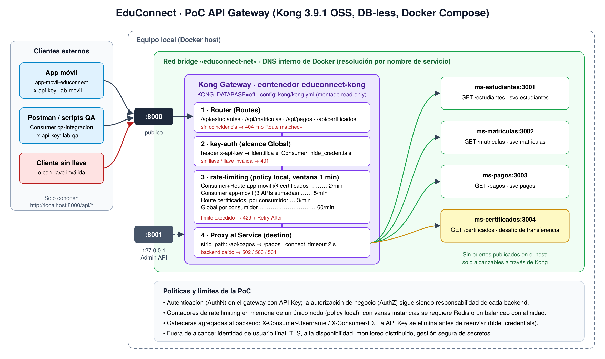
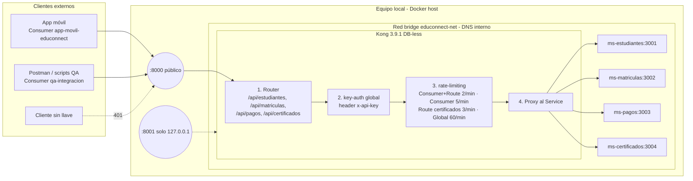

# Diagrama de arquitectura de la PoC

(Fuente vectorial editable: [`arquitectura.svg`](arquitectura.svg).)

## Versión Mermaid (se renderiza en GitHub/GitLab)

## Lectura del diagrama

| Elemento | Rol | Decisión clave |
|---|---|---|
| Puerto 8000 | Único punto de entrada público | Los backends no publican puertos; solo son alcanzables a través de Kong. |
| Puerto 8001 | Admin API | Publicado solo en `127.0.0.1` para consultar evidencias; nunca expuesto a la red. |
| Router (Routes) | Criterio de coincidencia | Prefijo `/api/<recurso>`, solo `GET`, `strip_path: true`. |
| key-auth | Autenticación del consumidor | Alcance global (seguro por defecto), llave solo en header, `hide_credentials`. |
| rate-limiting | Control de consumo | Cuatro alcances con precedencia Consumer+Route > Consumer > Route > Global. |
| Service | Destino | URL por nombre DNS de Compose; timeouts cortos para fallar rápido. |
| Red `educonnect-net` | Descubrimiento | DNS interno de Docker: Kong resuelve `ms-pagos` sin IP fija. |
